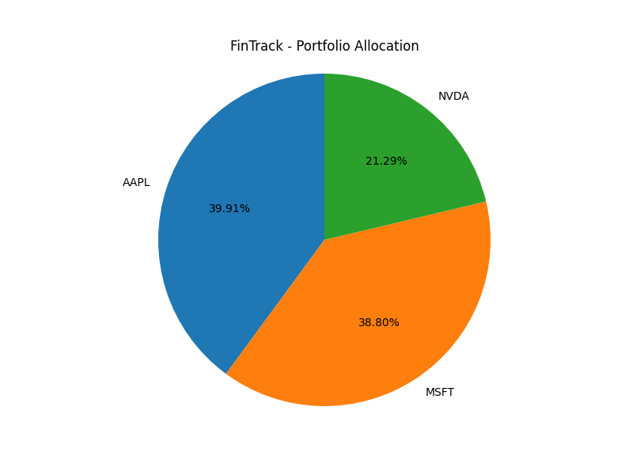
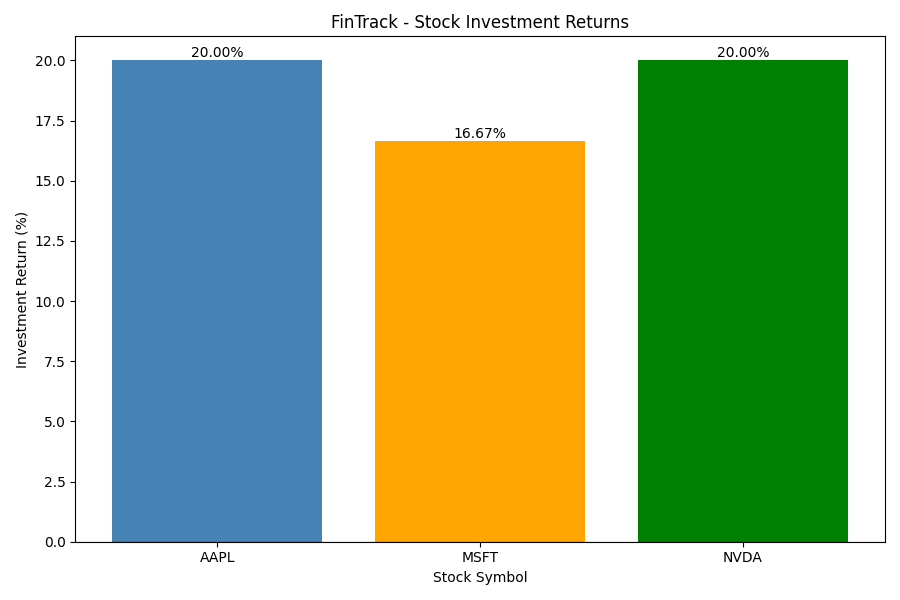
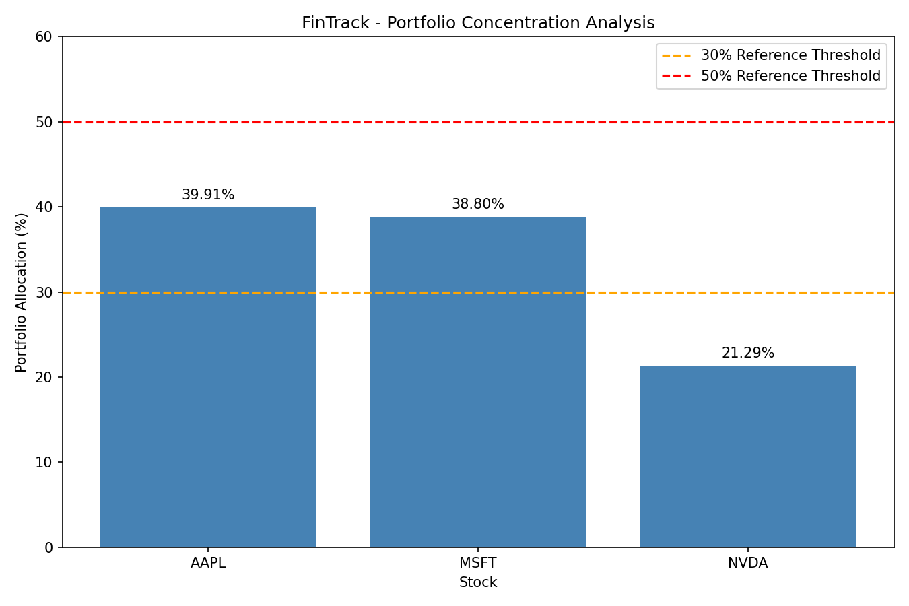

# FinTrack — Investment Analytics Platform

FinTrack is a Python-based investment analytics project
designed to evaluate simulated stock investments and
visualize portfolio performance.

## Purpose

This personal project helps develop software engineering
skills while exploring financial analytics and
quantitative development.

## Completed Features

- Individual stock investment calculations
- Portfolio profit/loss and percentage returns
- Total portfolio performance analysis
- Portfolio allocation calculations
- Portfolio allocation pie chart
- Investment performance bar chart
- Single-stock concentration risk indicator
- Portfolio concentration visualization

## Technologies Used

- Python
- Matplotlib
- Git and GitHub

## Project Structure

- backend/main.py — Portfolio calculations
- backend/visualization.py — Allocation pie chart
- backend/performance.py — Investment returns chart
- backend/risk_analysis.py — Concentration analysis
- backend/concentration_chart.py — Concentration chart
- docs/ — Generated visualizations
- frontend/ — Planned React dashboard
- data/ — Sample data directory

## Running FinTrack

Run the portfolio calculator:

    python3 backend/main.py

Run the risk analysis:

    python3 backend/risk_analysis.py

Generate the charts:

    python3 backend/visualization.py
    python3 backend/performance.py
    python3 backend/concentration_chart.py

Matplotlib is required for the visualizations.

## Example Portfolio Results

| Stock | Current Value | Return | Allocation |
|-------|--------------:|-------:|-----------:|
| AAPL | $1,800 | 20.00% | 39.91% |
| MSFT | $1,750 | 16.67% | 38.80% |
| NVDA | $960 | 20.00% | 21.29% |

Total invested: $3,800

Current portfolio value: $4,510

Total profit: $710

Overall return: 18.68%

## Portfolio Visualizations

### Portfolio Allocation

### Investment Returns

### Portfolio Concentration

## Future Development

- Interactive React dashboard
- FastAPI backend integration
- Historical stock price analysis
- PostgreSQL database
- Automated testing

## Disclaimer

All investments and stock prices are simulated.
FinTrack is an educational project and does not
provide financial advice.
